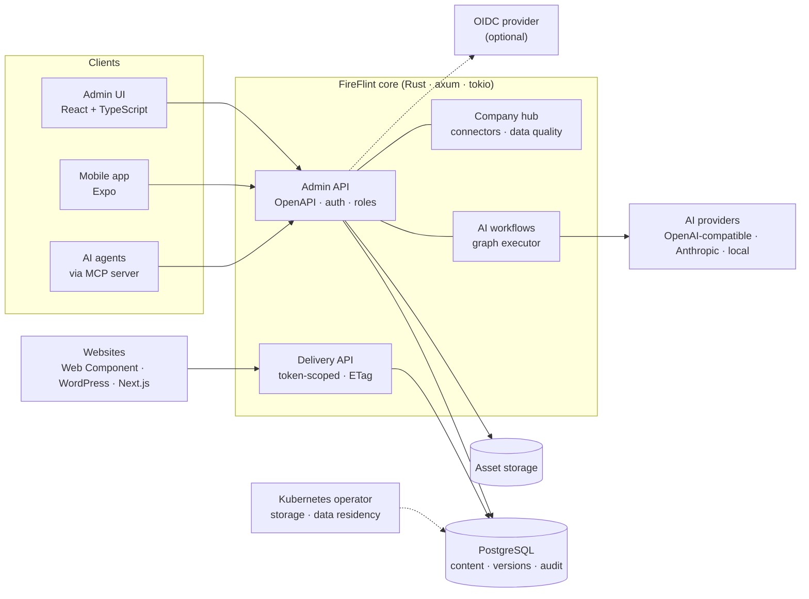

<p align="center">
  
</p>

<h1 align="center">FireFlint</h1>

<p align="center"><strong>Maintain content once — publish it safely to many websites.</strong></p>

<p align="center">
  <a href="LICENSE"></a>
  
  
  
  
  <a href="CONTRIBUTING.md"></a>
</p>

<p align="center">
  <a href="https://neurofunken.de"></a><br>
  <sub>a neurofunken project</sub>
</p>

---

FireFlint is an open-source, self-hostable **content and data hub** for agencies and organisations that run
several websites. Structured content — locations, teams, jobs, products, anything with a schema — is maintained
in one place, overridden per website where needed, and only goes live through an **explicit, revision-checked
publication**. A public delivery API, a Web Component and adapters for WordPress and Next.js bring the published
snapshot to any site. Optional AI workflows work with **any** model provider, and a built-in **MCP server** lets
AI agents operate FireFlint safely.

> **Status:** early open-source release (v0.1). The content core is used in a supervised production pilot;
> AI workflows, the operator and some modules are marked optional/experimental.

## Contents

- [Features](#features) · [Architecture](#architecture) · [Quick start](#quick-start) · [Configuration](#configuration)
- [AI providers](#ai-providers-vendor-neutral) · [MCP server](#mcp-server) · [Agent skill](#agent-skill)
- [Documentation](#documentation) · [Contributing](#contributing) · [License](#license) · [Deutsch](#kurzfassung-deutsch)

## Features

- **Central content, local overrides** — content types with JSON schemas, per-website overrides and a visible
  impact preview before anything is published.
- **Safe publishing** — every write carries an `expected_revision`; conflicts are surfaced, never silently
  overwritten. Versioning, revert, scheduling and a full audit log are built in.
- **Delivery anywhere** — token-scoped public delivery API with ETags and rate limits, a framework-free
  Web Component, plus WordPress and Next.js adapters.
- **Identity & access** — owner/editor/viewer roles, password login, optional OIDC (Keycloak or any standards-compliant provider) with
  PKCE, back-channel logout and session revocation.
- **Company hub & connectors** — import from CSV, HubSpot, Odoo, Shopify, WooCommerce and Nextcloud with
  data-quality checks.
- **Optional AI workflows** — visual graph builder (agents, conditions, loops, memory), chat copilot, per-node
  token budgets; providers: OpenAI-compatible (OpenAI, Mistral, OpenRouter, Ollama, LM Studio, vLLM …),
  Anthropic, or a deterministic mock.
- **Agent-ready** — MCP server (`mcp/`) and an Agent Skill (`skills/fireflint`) for Claude, Codex, Grok Bot or
  local models.
- **Cloud-native operations** — production container, Helm chart, tested backup/restore and a Kubernetes
  operator (kube-rs) for storage and data residency.

## Architecture



More detail: [docs/ARCHITECTURE.md](docs/ARCHITECTURE.md).

## Quick start

```sh
# Requirements: Rust (stable), Node.js 22+, Podman, Python 3
git clone <this-repo> fireflint && cd fireflint
./run-local.sh        # PostgreSQL (container) + API on :8090 + admin UI
./stop-local.sh       # stop again (add --db to also stop the database)
```

- Admin UI: the URL printed by `run-local.sh` · API docs: `http://127.0.0.1:8090/openapi.json`
- The demo seed contains **fictitious** organisations and a demo delivery token only.
- Manual runs: `cp deploy/.env.example .env`, set `DATABASE_URL` and `JWT_SECRET`, then
  `cargo run -p sitegraph-bin` and `cd admin && npm ci && npm run dev`.
- Production: see [docs/SAAS-DEPLOYMENT.md](docs/SAAS-DEPLOYMENT.md) and the Helm chart in `deploy/saas/`.

## Configuration

Configuration is environment-based; see [`deploy/.env.example`](deploy/.env.example) and
[docs/CONFIGURATION.md](docs/CONFIGURATION.md). The most important settings:

| Variable | Purpose |
| --- | --- |
| `DATABASE_URL` | PostgreSQL connection string |
| `JWT_SECRET` | Signing key for access tokens — long random value, required in production |
| `AI_CONNECTOR_ENCRYPTION_KEY` | Encrypts stored AI provider keys — distinct from `JWT_SECRET` |
| `APP_ENV` | `production` enforces guardrails (strong secrets, CORS allowlist, …) |
| `CORS_ALLOWED_ORIGINS` | Comma-separated admin/front-end origins |
| `ASSET_DIR` | Media storage directory |
| `OIDC_ISSUER_URL`, `OIDC_LABEL`, `OIDC_REQUIRE_APP_GROUP` | Optional single sign-on |
| `AI_ALLOWED_PROVIDER_HOSTS`, `AI_ALLOW_PRIVATE_PROVIDERS` | AI egress allowlist (see below) |
| `VITE_PUBLIC_ORIGIN`, `VITE_OPERATOR_*` | Admin build: public origin and legal-notice operator details |

## AI providers (vendor-neutral)

AI features are optional — all content workflows run without AI. Owners add AI connectors per organisation in
the admin UI (*KI-Agenten*):

| Provider value | Works with | Base URL example | Model example |
| --- | --- | --- | --- |
| `openai_compatible` | OpenAI | `https://api.openai.com/v1` | `gpt-4o-mini` |
| `openai_compatible` | Mistral | `https://api.mistral.ai/v1` | `mistral-small-latest` |
| `openai_compatible` | OpenRouter (many vendors) | `https://openrouter.ai/api/v1` | `anthropic/claude-sonnet-4` |
| `openai_compatible` | Ollama · LM Studio · vLLM (local) | `http://localhost:11434/v1` | `llama3.2` |
| `anthropic` | Anthropic Messages API | `https://api.anthropic.com` | `claude-sonnet-4-6` |
| `mock` | Tests, demos, offline | – | – |

Outbound AI traffic is SSRF-protected: only `api.openai.com` and `api.anthropic.com` are approved by default.
Add other hosts with `AI_ALLOWED_PROVIDER_HOSTS=api.mistral.ai,openrouter.ai`; local/private endpoints also need
`AI_ALLOW_PRIVATE_PROVIDERS=true`. Provider keys are stored encrypted and never returned by the API.
Details: [docs/AI-PROVIDERS.md](docs/AI-PROVIDERS.md).

## MCP server

`mcp/` contains a dependency-free [Model Context Protocol](https://modelcontextprotocol.io) server (Node.js ≥ 20,
stdio transport) that exposes FireFlint's key operations to any MCP client — Claude, Codex, Cursor, LM Studio,
Grok Bot or your own agent running a local model.

### Tools

| Tool | Kind | Purpose |
| --- | --- | --- |
| `fireflint_health` | read | Health, readiness and version |
| `fireflint_me` | read | Current user and memberships |
| `fireflint_list_websites` | read | Websites (delivery channels) of an org |
| `fireflint_list_content_types` | read | Content types and JSON schemas |
| `fireflint_list_content` | read | List/search content of a type |
| `fireflint_get_content` | read | One content object incl. revision |
| `fireflint_get_published` | read | Published content via delivery API |
| `fireflint_create_content` | write | Create a draft (validated) |
| `fireflint_update_content` | write | Update a draft with `expected_revision` |
| `fireflint_publish_content` | write | Publish a checked revision (human approval!) |

Write tools are hidden when `FIREFLINT_READ_ONLY=true`. Errors from the API are returned as tool errors
(`isError: true`) with the HTTP status, never with credentials.

### Configuration

All settings come from environment variables — **no secrets are stored in this repository**.

| Variable | Example | Required | Description |
| --- | --- | --- | --- |
| `FIREFLINT_BASE_URL` | `http://127.0.0.1:8090` | yes | FireFlint API base URL |
| `FIREFLINT_TOKEN` | `<access-token>` | one of | Admin API access token (Bearer) |
| `FIREFLINT_EMAIL / FIREFLINT_PASSWORD` | `<user> / <password>` | one of | Log in at startup via `/auth/login` instead of a token |
| `FIREFLINT_ORG_ID` | `<org-uuid>` | no | Default organisation for all tools |
| `FIREFLINT_DELIVERY_TOKEN` | `<delivery-token>` | no | Enables `fireflint_get_published` |
| `FIREFLINT_READ_ONLY` | `true` | no | Hide all write tools |

### Client setup

**Claude Desktop / Cursor / generic MCP JSON** (`claude_desktop_config.json`, `.cursor/mcp.json`, …):

```json
{
  "mcpServers": {
    "fireflint": {
      "command": "node",
      "args": ["/absolute/path/to/fireflint/mcp/src/server.mjs"],
      "env": {
        "FIREFLINT_BASE_URL": "http://127.0.0.1:8090",
        "FIREFLINT_TOKEN": "<access-token>",
        "FIREFLINT_ORG_ID": "<org-uuid>"
      }
    }
  }
}
```

**Claude Code:**

```sh
claude mcp add fireflint --env FIREFLINT_BASE_URL=http://127.0.0.1:8090 --env FIREFLINT_TOKEN=<access-token> --env FIREFLINT_ORG_ID=<org-uuid> -- node /absolute/path/to/fireflint/mcp/src/server.mjs
```

**OpenAI Codex CLI** (`~/.codex/config.toml`):

```toml
[mcp_servers.fireflint]
command = "node"
args = ["/absolute/path/to/fireflint/mcp/src/server.mjs"]
env = { FIREFLINT_BASE_URL = "http://127.0.0.1:8090", FIREFLINT_TOKEN = "<access-token>", FIREFLINT_ORG_ID = "<org-uuid>" }
```

**Run / test directly:**

```sh
cd mcp && npm test                       # unit tests against a mock API
FIREFLINT_BASE_URL=http://127.0.0.1:8090 node mcp/src/server.mjs   # speaks MCP on stdin/stdout
```

## Agent skill

[`skills/fireflint/SKILL.md`](skills/fireflint/SKILL.md) is an [Agent Skill](https://agentskills.io) (YAML frontmatter with
`name` + `description`, followed by step-by-step instructions). It teaches an agent the safe workflow on top of
the MCP tools: read schemas first, write drafts, resolve conflicts deliberately, and ask a human before anything
goes live.

- **Claude Code / Claude apps:** copy `skills/fireflint` to `~/.claude/skills/fireflint` (or `.claude/skills/` in a project).
- **Codex:** copy it to `~/.codex/skills/fireflint` (or reference it from `AGENTS.md`).
- **Grok Bot and other agents:** add the folder as a skill, or paste `SKILL.md` into the agent's instructions.
- **Local models (Ollama, LM Studio, …):** use `SKILL.md` as system prompt together with the MCP server.
## Documentation

| Document | Topic |
| --- | --- |
| [docs/ARCHITECTURE.md](docs/ARCHITECTURE.md) | Components, data model, request flows |
| [docs/CONFIGURATION.md](docs/CONFIGURATION.md) | All environment variables |
| [docs/AI-PROVIDERS.md](docs/AI-PROVIDERS.md) | Provider setup and security model |
| [docs/MCP-AND-SKILLS.md](docs/MCP-AND-SKILLS.md) | MCP server and agent skill |
| [docs/SAAS-DEPLOYMENT.md](docs/SAAS-DEPLOYMENT.md) | Production deployment (German) |
| [docs/KEYCLOAK.md](docs/KEYCLOAK.md) | OIDC / Keycloak integration (German) |
| [docs/CONNECTORS.md](docs/CONNECTORS.md) | Company-hub connectors (German) |
| [docs/security/](docs/security/) · [docs/adr/](docs/adr/) | Threat model and architecture decisions |
| [docs/README.de.md](docs/README.de.md) | Full German project documentation |

## Contributing

Contributions are welcome — bugs, docs, tests and features. Please read [CONTRIBUTING.md](CONTRIBUTING.md) and the
[Code of Conduct](CODE_OF_CONDUCT.md). Report vulnerabilities privately as described in [SECURITY.md](SECURITY.md).

## License

[MIT](LICENSE) © 2026 Hanns Leonhard Osterbrink / neurofunken.

---

## Kurzfassung (Deutsch)

FireFlint ist ein quelloffener, selbst hostbarer Content- und Daten-Hub: Inhalte wie Standorte, Teams oder Jobs
werden **einmal gepflegt**, pro Website gezielt überschrieben und erst durch eine **ausdrückliche,
revisionsgeprüfte Veröffentlichung** live geschaltet. Rust-Kern mit PostgreSQL, React-Admin-Oberfläche,
Delivery-API, Web Component, WordPress- und Next.js-Adapter, Konnektoren, Kubernetes-Operator und Helm-Chart.
KI ist optional und **anbieterneutral** (OpenAI-kompatibel inkl. Mistral, OpenRouter, Ollama, LM Studio – oder
Anthropic). Ein **MCP-Server** und ein **Agent Skill** machen FireFlint für Claude, Codex, Grok Bot oder lokale
Modelle nutzbar. Schnellstart: `./run-local.sh`. Ausführliche Doku: [docs/README.de.md](docs/README.de.md).

<p align="center"><sub>Built with care by <a href="https://neurofunken.de">neurofunken</a>.</sub></p>
