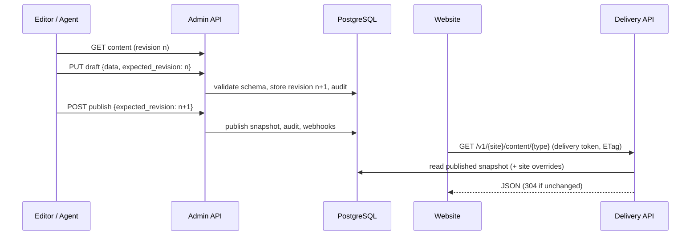

# FireFlint architecture

FireFlint is a Rust workspace with a React admin UI. The core idea: **content is maintained once, overridden per
website, and published as an explicit, revision-checked snapshot** that delivery clients read.

## Components

| Component | Path | Responsibility |
| --- | --- | --- |
| Domain | `crates/sitegraph-domain` | Content types, schema validation, override merge rules |
| Database | `crates/sitegraph-db` | PostgreSQL access (sqlx), migrations in `migrations/` |
| API | `crates/sitegraph-api` | axum HTTP API: auth, admin, delivery, webhooks, AI workflows, connectors, outbound SSRF guard |
| Binary | `crates/sitegraph-bin` | Runtime configuration, production guardrails, server start |
| Foundation | `crates/foundation/*` | Reusable building blocks: identity/access, event audit, party, asset, work, time/resource |
| Platform | `crates/platform/*` | Company hub and data residency |
| Operator | `operator/*` | Kubernetes operator (kube-rs) for storage targets and bindings |
| Admin UI | `admin/` | React + TypeScript (Vite) |
| Mobile | `mobile/` | Expo app |
| Adapters | `adapters/` | Web Component, WordPress plugin, Next.js helper, FlintPlate contract |
| MCP server | `mcp/` | Model Context Protocol bridge for AI agents |

## Data flow

## Security principles

- Every editor mutation requires the current revision; conflicts return HTTP 409 and are never auto-retried.
- Server-side authorization per organisation and role; the UI only mirrors it.
- Delivery tokens are hashed, scoped to channels and rate-limited.
- Outbound requests (webhooks, connectors, AI) pass an SSRF guard with DNS pinning; credentials are never
  forwarded on redirects.
- Production mode refuses weak or shared secrets (`JWT_SECRET`, `AI_CONNECTOR_ENCRYPTION_KEY`).

See also [security/data-residency-threat-model.md](security/data-residency-threat-model.md) and
[adr/](adr/).
